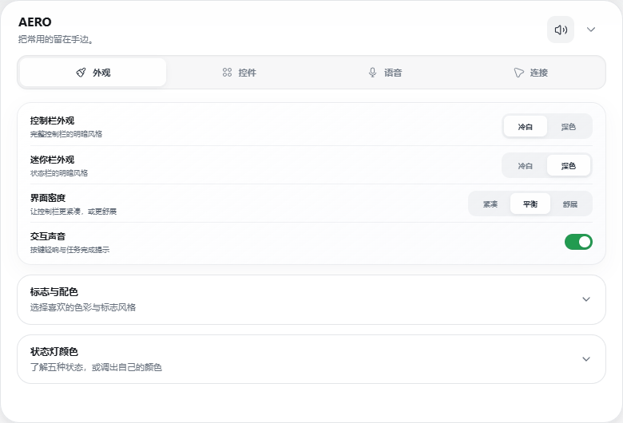

# AERO

[简体中文](README.md) · **English**

Keep your tasks in sight.

AERO is a Windows desktop companion for Codex Desktop. Six task lights and a lightweight floating bar help you switch less and stay focused.

[Download Beta 8](https://github.com/AeolusV/AERO-Releases/releases/tag/v0.1.0-beta.8) · [User guide](USAGE.en.md) · [What's new](CHANGELOG.md)

## Stay aware. Stay with your work.

Follow six tasks at a glance. Hover to see the workspace and task name; click to return to that conversation. When a task finishes, blue turns green. A soft completion sound is optional.

## Familiar actions, within reach.

Create, continue or pause a task, respond to requests, and choose the reasoning effort available for your model. Collapse the bar when you need more space. Both forms can be dragged freely or snapped to a screen edge.

## Make it yours.

Choose light or dark for each bar. Adjust the lamp colors, sounds and control order, and keep only what you use.

## Say Hey Codex. Keep talking.

AERO recognizes the wake phrase locally. It then pauses listening, releases the microphone and opens Codex Voice. Prepare the optional voice files in Settings once; wake recognition can then work offline. Codex Voice conversations require internet access and use your own Codex account and allowance.

[Set up voice wake-up](USAGE.en.md#hey-codex)

## Get started

Download the Windows x64 ZIP from Releases, extract the entire folder and open `AERO.exe`. A signed-in Codex Desktop is required. The current Beta is unsigned; verify the download source and checksum.

This repository contains release builds, user documentation and license notices. AERO's application source is not published here.

## Permission to use

© 2026 Aeolus. AERO is closed-source software. Permission is limited to using the author's unmodified releases and keeping necessary personal backups. Modification, rewriting, redistribution, repackaging or reverse engineering of protected original implementations requires written permission, except as permitted by law. See [LICENSE](LICENSE) and [THIRD_PARTY_NOTICES.md](THIRD_PARTY_NOTICES.md).

By Aeolus.
