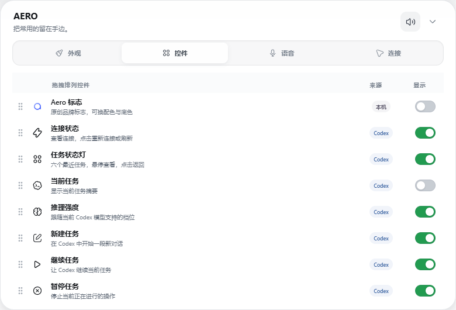
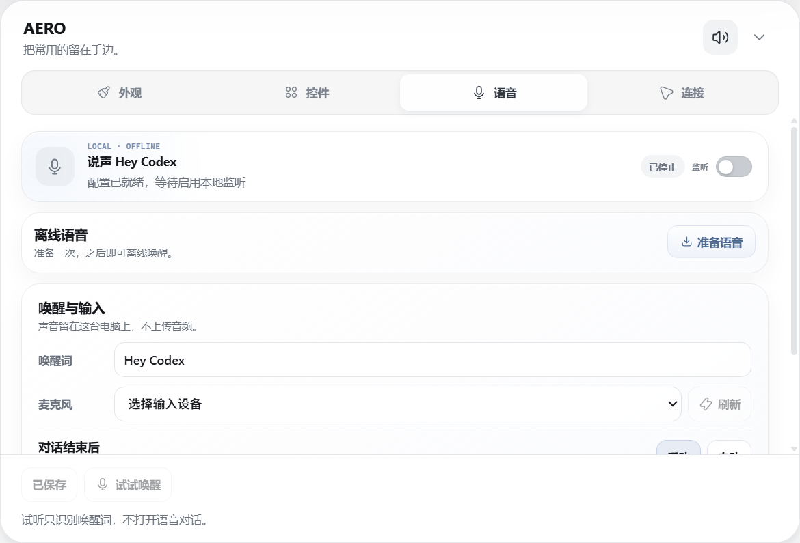
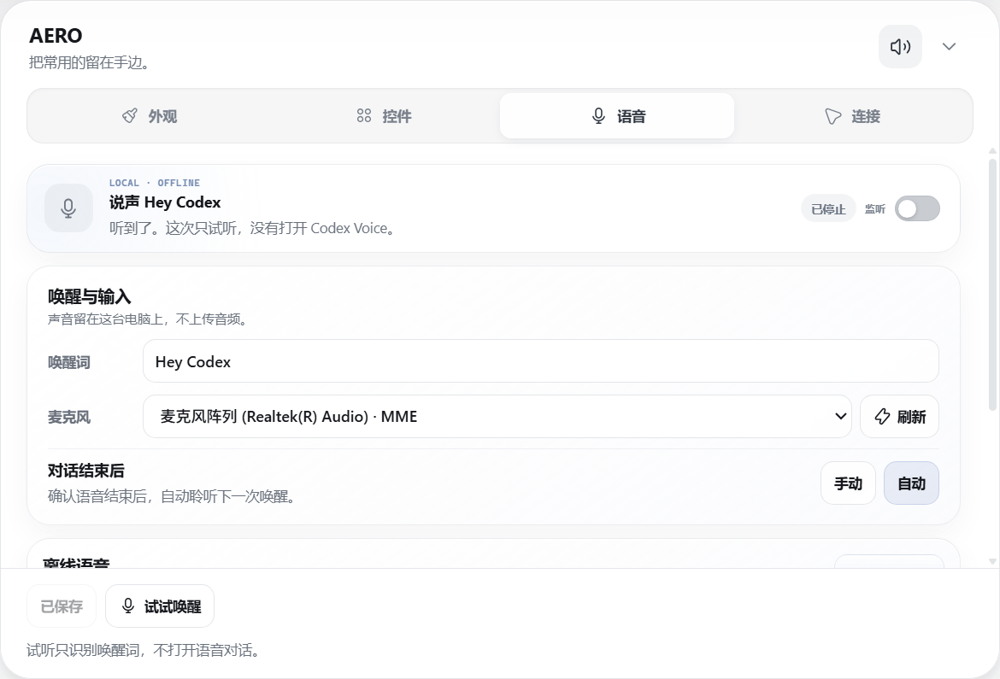

# Using AERO

[简体中文](USAGE.md) · **English** · [Back to AERO](README.en.md)

## Install and open

1. Open Codex Desktop and sign in.
2. Download the Windows x64 ZIP and matching `.sha256` file from [Beta 8](https://github.com/AeolusV/AERO-Releases/releases/tag/v0.1.0-beta.8).
3. Extract the entire folder, keep its files together and open `AERO.exe`.

Node.js is not required. This Beta is unsigned. Verify the author-provided download source and checksum before proceeding through a Windows warning. In PowerShell, use `Get-FileHash -LiteralPath 'full-path-to-package.zip' -Algorithm SHA256` and compare it with the `.sha256` file.

To update, exit AERO from its tray menu, extract the new package to a new folder and open it. Existing appearance and voice settings are retained.

## Six lights, six tasks

| Color | Meaning |
| --- | --- |
| White | Idle |
| Blue | Working |
| Green | Complete |
| Yellow | Needs input or approval |
| Pink | Needs attention |

Hover to see the workspace and task name. Click a light to return to its conversation. Customize the colors in Settings.

Collapse the full bar using its right-side button. Use the mini bar's rightmost button to expand it. Drag either bar freely or snap it to an edge.

## Make it yours

Appearance settings include light and dark styles, density, sounds and lamp colors. In Controls, drag the left handle to reorder items and use the right switch to show or hide each one.

## Hey Codex

1. Set the Voice shortcut in Codex Desktop to `Ctrl+Shift+V`.
2. In AERO, open Settings → Voice and prepare the voice files.
3. Select your microphone and enter `Hey Codex` as the wake phrase.
4. Pause listening and end Codex Voice, then try the wake phrase within 30 seconds. The listening test does not open Voice.
5. Enable listening and say Hey Codex. AERO pauses, releases the microphone and opens Codex Voice.

After the conversation, resume listening manually. Optional automatic resume waits for confirmation that Codex Voice has ended. If that confirmation is unavailable, listening stays paused and can be resumed manually.

Wake recognition runs locally without uploading audio or consuming Codex allowance. Recording and routine transcripts are not saved by default. Codex Voice conversations need internet access and use Codex's own allowance.

You can also select an existing Python environment with Vosk and sounddevice and an extracted `vosk-model-small-en-us-0.15` model in advanced settings. Models come from [Vosk](https://alphacephei.com/vosk/models). Automatic setup downloads the model and its required runtime files.

## Tray and exit

Closing the bar hides AERO to the tray; enabled listening continues. Right-click the tray icon to show the bar, open Voice or exit. Exiting stops AERO's listener.

## Need help?

For connection issues, confirm Codex is open and signed in. For wake issues, pause, reselect your microphone and try again. If the phrase is heard without opening Voice, check whether you are in the listening test and verify the Codex shortcut.

If AERO reports modified or damaged files, download a fresh author-published package and extract it fully. Do not mix files from different versions or disable system security. Report issues with your Windows, Codex and AERO versions; private conversations and sign-in files are not needed.

## Permission to use

Permission covers unmodified author-published releases and necessary personal backups only. Modification, rewriting, redistribution, repackaging and reverse engineering of protected original implementations require written permission, except as permitted by law. See [LICENSE](LICENSE). The complete license is also available under Settings → Connections → License.
